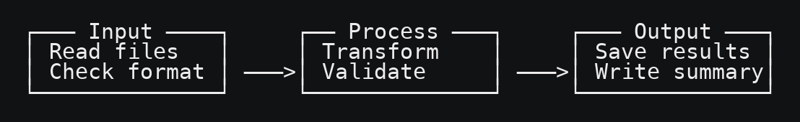

# Text diagrams

Build diagrams from XML, embed them in Markdown, and export them as PNGs.

## Quick start

```sh
python3 -m venv .venv
source .venv/bin/activate
pip install -e .
diagram-build examples/workflow.xml
diagram-export examples/workflow.md --output-dir examples/rendered
```



Edit `examples/workflow.xml` to change the example. Layouts include `box`, `row`,
`stack`, `text`, `place-line`, and `place-lines`. A `between` element connects
adjacent blocks in a row. Widths and positions are measured in character cells.

The XML `target` is relative to its directory (override with `--root`). The target
Markdown must exist and contain matching `text-diagram:ID:start` and
`text-diagram:ID:end` HTML comments. The builder replaces their contents.

Exports use a dark background. Use `--theme light`, or set `--background` and
`--foreground`. Adjust `--font-size`, `--padding`, and `--line-spacing` as needed.
The exporter looks for an installed monospace font by name; use `--font` to
select a font file. Use single-cell characters for consistent alignment.
Run either command with `--help` for all options.

## Tests

```sh
python -m unittest discover -s tests -v
```
